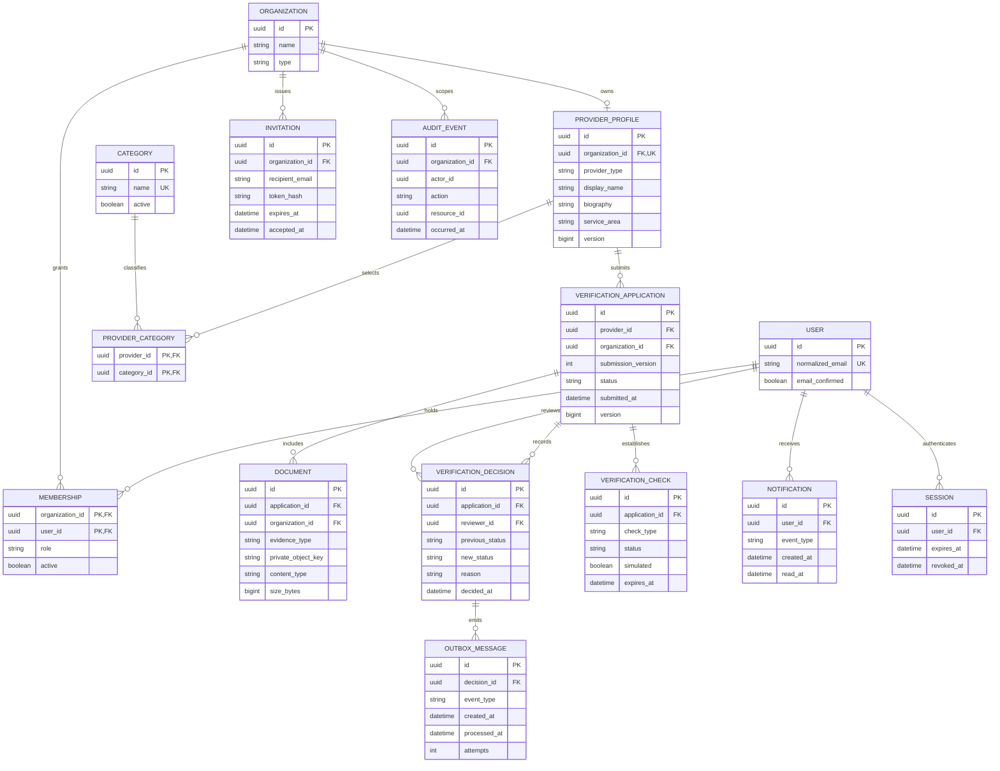

# Milestone A domain model

Status: Conceptual design before migrations. ASP.NET Core Identity supplies credential and token mechanics; this diagram shows product relationships rather than its complete framework schema.

## Invariants

- Normalized email is unique; memberships are unique per user/organization.
- One provider profile per provider organization initially. An individual provider has the same ownership boundary as a business.
- An application/document organization must match its provider organization; use composite constraints where appropriate.
- Allow only one active submitted/under-review application per provider. Submission versions are immutable.
- A decision requires the application's current concurrency version. Write its state change, checks, audit event, notifications, and outbox records in one transaction.
- Approval identifies individual checks; public badges require approved, unexpired, unsuspended checks and current provider eligibility.
- Identity/business edits invalidate affected checks. Public projections exclude documents and storage references.
- Invitations are expiring and single-use. Sessions must support revocation; framework-managed cookies must honor this state.
- UTC timestamps are authoritative. Nullable timestamps represent events that have not occurred or checks without configured expiry.

Milestones B/C extend this model with customer properties, services, scheduling, bookings, reviews, partner clients, idempotency, and webhook deliveries. Their schema is not finalized here.
